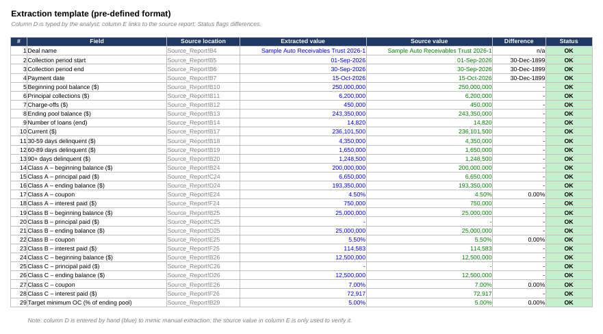
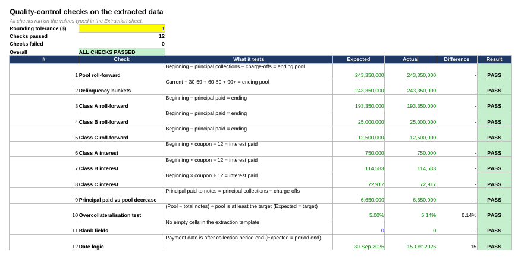
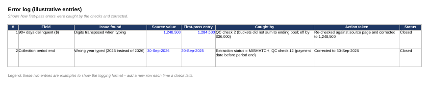

# Trustee Report Data Extraction & QC Tracker

An Excel workbook that practises a core Credit Operations task: taking figures from a **trustee (pool performance) report**, entering them into a **pre-defined template**, and **quality-checking** the result before it is used.

> **Fictional data.** The report describes a made-up auto-loan securitisation, *Sample Auto Receivables Trust 2026-1*. It is not a real transaction.

## Why I built it

Analysts supporting a credit rating team regularly extract data from trustee reports into a fixed format and have to catch errors before they reach the global team. This project shows that workflow end to end: extract, reconcile, check, log.

## What's inside

| Sheet | Purpose |
|-------|---------|
| `README` | Purpose, colour code, assumptions |
| `Source_Report` | Mock monthly trustee report: pool activity, delinquency buckets, three note classes (A, B, C), target overcollateralisation |
| `Extraction` | The pre-defined template (29 fields). Column D is typed by hand; column E links to the source; the Status column shows `OK` or `MISMATCH` |
| `QC_Checks` | 12 automatic quality-control checks with PASS / FAIL results and an overall status |
| `Error_Log` | Illustrative log of two first-pass errors, how they were caught and how they were fixed |

## The 12 quality-control checks

| # | Check | What it tests |
|---|-------|---------------|
| 1 | Pool roll-forward | Beginning − principal collections − charge-offs = ending pool |
| 2 | Delinquency buckets | Current + 30-59 + 60-89 + 90+ = ending pool |
| 3–5 | Note roll-forwards (A, B, C) | Beginning − principal paid = ending balance |
| 6–8 | Interest recalculation (A, B, C) | Beginning × coupon ÷ 12 = interest paid |
| 9 | Principal vs pool decrease | Principal paid to notes = principal collections + charge-offs |
| 10 | Overcollateralisation test | (Pool − total notes) ÷ pool is at least the 5.00% target |
| 11 | Blank fields | No empty cells in the template |
| 12 | Date logic | Payment date is after the collection period end |

All 12 checks pass on the final data (overcollateralisation is 5.14% against a 5.00% target).

## Screenshots

**Extraction template**

**Quality-control checks**

**Error log**

## How to use it

1. Open `Trustee_Report_Extraction_QC_Tracker.xlsx` in Excel.
2. Read the `Source_Report` sheet, then look at how the `Extraction` template is filled.
3. Change a value in `Extraction` column D (for example, swap two digits in a delinquency bucket) and watch the Status column and `QC_Checks` react.
4. To reuse it with a real public trustee report, replace the figures on `Source_Report`, retype them on `Extraction`, and confirm all checks still pass.

**Colour code:** blue text = typed-in input · black = formula · green = link to another sheet · yellow fill = assumption you can change.

## Assumptions and limitations

- Interest is recalculated as beginning balance × coupon ÷ 12 (30/360 monthly), rounded to whole dollars, with a $1 rounding tolerance (`QC_Checks!B3`).
- The 5.00% minimum overcollateralisation target is invented for practice.
- Column D of `Extraction` is typed by hand on purpose, to mimic manual extraction; the source value in column E is only used to verify it.
- The structure is simplified: real transactions have waterfalls, reserve accounts, triggers and more note classes.

## Skills shown

Excel formulas (`IF`, `ABS`, `ROUND`, `COUNTIF`, `COUNTBLANK`, `SUM`), conditional formatting, reconciliation, quality control, structured-finance terminology, documentation.

## Author

Anjali Yanumula · [LinkedIn](https://www.linkedin.com/in/anjali-yanumula-1b4393325)
