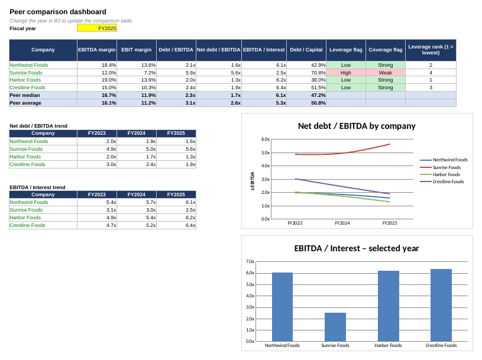
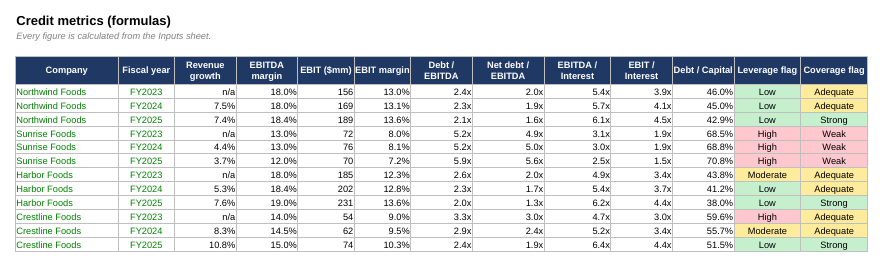

# Company & Peer Credit Metrics Dashboard

An Excel workbook that turns annual financials into **credit metrics** and compares each company with its **peer group**. It practises the task of maintaining company and peer credit metrics from historical financial data.

> **Fictional data.** The four packaged-food companies (Northwind, Sunrise, Harbor and Crestline Foods) and all figures are made up for practice. Replace them with figures from real annual reports to make this a live analysis.

## What's inside

| Sheet | Purpose |
|-------|---------|
| `README` | Purpose, definitions, colour code |
| `Peer_Summary` | Dashboard: pick a fiscal year (cell B3), see each company's metrics, the peer median and average, a leverage rank, trend tables and two charts |
| `Assumptions` | Editable thresholds for the leverage and coverage flags |
| `Inputs` | Flat table, one row per company-year (US$ mm): revenue, EBITDA, D&A, interest expense, total debt, cash, equity |
| `Metrics` | All ratios calculated by formula from `Inputs` |

## Metrics calculated

| Metric | Definition |
|--------|------------|
| Revenue growth | Revenue ÷ prior-year revenue − 1 |
| EBITDA margin / EBIT margin | EBITDA (or EBIT) ÷ revenue, where EBIT = EBITDA − D&A |
| Debt / EBITDA | Total debt ÷ EBITDA |
| Net debt / EBITDA | (Total debt − cash) ÷ EBITDA |
| EBITDA / Interest and EBIT / Interest | Earnings ÷ interest expense |
| Debt / Capital | Total debt ÷ (total debt + total equity) |
| Leverage flag | High if net debt/EBITDA is above 3.0x, Moderate above 2.0x, otherwise Low |
| Coverage flag | Weak if EBITDA/interest is below 4.0x, Adequate below 6.0x, otherwise Strong |

The flag thresholds are **illustrative** and are not any rating agency's methodology. Change them on the `Assumptions` sheet.

## What the sample data shows (FY2025)

- **Sunrise Foods** is the weakest peer: net debt/EBITDA of 5.6x and EBITDA/interest of 2.5x, against a peer median of 1.7x and 6.1x.
- Sunrise's net leverage rose from 4.9x in FY2023 to 5.6x in FY2025, while its coverage fell from 3.1x to 2.5x.
- **Harbor Foods** has the lowest leverage (1.3x) and **Crestline Foods** the highest coverage (6.4x). Both improved every year.

## Screenshots

**Peer dashboard**

**Metrics sheet**

## How to use it

1. Open `Company_Peer_Credit_Metrics_Dashboard.xlsx` in Excel.
2. On `Peer_Summary`, change the fiscal year in cell B3 (2023, 2024 or 2025) and watch the table update.
3. Change the thresholds on `Assumptions` to see the flags move.
4. To use real data, overwrite the blue cells on `Inputs` (and note each source in column J). The `Metrics` and `Peer_Summary` sheets recalculate automatically.

**Colour code:** blue text = typed-in input · black = formula · green = link to another sheet · yellow fill = assumption you can change.

## Power BI option

`Inputs` is a flat table with one row per company-year, so it can be loaded straight into Power BI to rebuild the same view as an interactive dashboard.

## Limitations

- Four companies and three years of fictional data; a real peer group would use audited filings and consistent definitions across companies.
- No adjustments for leases, pensions or one-off items.
- Flags are a simple screen, not a credit opinion.

## Skills shown

Excel (`SUMIFS`, `MEDIAN`, `AVERAGE`, `RANK`, `IFERROR`, conditional formatting, charts), financial ratio analysis, peer comparison, documentation of assumptions.

## Author

Anjali Yanumula · [LinkedIn](https://www.linkedin.com/in/anjali-yanumula-1b4393325)
